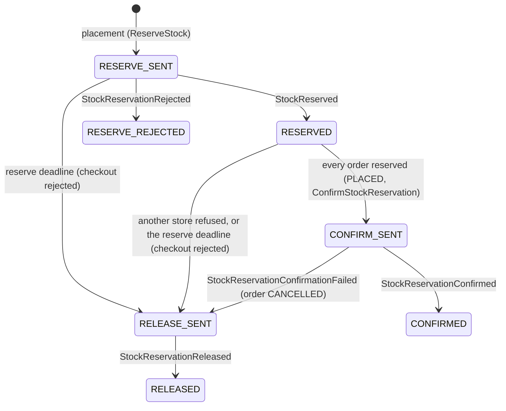

# Flow: Checkout placement (cart → order → stock)

Status: **partly built** (ADR 0007). order-service consumes `PlaceCheckout` (listener off until the go-live gates, D1),
answers every pre-reserve failure with `CheckoutRejected`, places a passing checkout and runs the stock saga to
`CONFIRMED`. Not built: cart-service, `by-key/expire`, delivery quotes (the
fee stays null, D2), auto-accept and accept/reject, cancel.
Inventory's side is built (ADR 0006, `order-stock-reservation.md`). Rules: BR-CRT-03/04, BR-ORD-01..05, 08, 10, 14..16, BR-MER-05,
BR-STO-04/05/07, BR-PRC-01/03, BR-FUL-03.

## Happy path

```mermaid
sequenceDiagram
    participant W as oms-web
    participant K as cart-service
    participant O as order-service
    participant S as stores-service
    participant I as inventory-service
    W->>O: delivery quotes per store (fee shown, BR-PRC-03)
    W->>K: POST checkout (If-Match: cart version; address typed, BR-ORD-15)
    K->>K: tx: cart CHECKING_OUT + outbox PlaceCheckout (key cartId)
    K-->>O: PlaceCheckout
    O->>O: look up checkout by (cartId, cartVersion)
    O->>S: order-quote per store (store snapshot and config, merchant status, open + reasons, local date, SKU prices) — outside the tx
    O->>O: tx: insert checkout PENDING (unique key), one order per store PENDING, outbox ReserveStock × N, daily-cap slots last
    I-->>O: StockReserved × N (each in its own tx; the checkout row lock orders them)
    O->>O: tx (on the last one): every order PLACED, order numbers; outbox ConfirmStockReservation × N + CheckoutPlaced
    O-->>K: CheckoutPlaced → cart CHECKED_OUT
    I-->>O: StockReservationConfirmed → the store sees the order (BR-ORD-16)
    O->>O: auto-accept, or staff accept / reject within 5 minutes (BR-STO-05, BR-ORD-08)
```

## One outcome per checkout key

The `checkouts` row is unique on `(cart_id, cart_version)`. Whoever inserts it first decides the outcome.

| Case | order-service | Reply |
|---|---|---|
| Key exists, same content | nothing new | the stored outcome again (nothing while `PENDING`) |
| Key exists, different content | nothing | `CheckoutRejected{CONTENT_MISMATCH}` (not an outcome for the cart) |
| No key, `requestedAt` too old | insert `STALE` | `CheckoutRejected{STALE}` |
| No key | insert `PENDING`, place | `CheckoutPlaced` or `CheckoutRejected` with reasons |
| cart calls `by-key/expire` (11 min after `requestedAt`), no key | insert `EXPIRED` | `EXPIRED` → cart `ACTIVE` (version + 1) |
| cart calls `by-key/expire`, key exists | nothing | the stored outcome: `PLACED` → `CHECKED_OUT`; `REJECTED` / `STALE` / `EXPIRED` → `ACTIVE`; `PENDING` → the cart asks again later |

Placement and expiry insert under the same unique key (`INSERT … ON CONFLICT DO NOTHING`; the loser writes nothing and re-reads the row), so they never both succeed (ADR 0007). The cart ignores `CONTENT_MISMATCH` and alerts.

## Rejections and timeouts

- Any store or line fails a check (merchant suspended, store not `ACTIVE` or closed, daily cap, SKU, currency, fee
  changed, stores-service unavailable) → nothing is reserved; `CheckoutRejected` with a reason per store or line.
- Once every store has answered its reserve (D3), any `StockReservationRejected` → every order of the checkout is
  rejected and every reservation released (all-or-nothing, BR-ORD-14); daily-cap slots are freed; one
  `CheckoutRejected` lists every reason (inventory's line reasons with store and SKU; `STALE_COMMAND` →
  `RESERVE_TIMEOUT`, `ORDER_CLOSED` → `RESERVE_FAILED`).
- No `ConfirmStockReservation` reply → re-sent from 150 s with a doubling interval up to 10 minutes, never cancelled
  for silence (BR-ORD-16); a `ReleaseStockReservation` without a reply is re-sent the same way. ERROR and alert metric
  from attempt 3. `StockReservationConfirmationFailed` → the order is cancelled (`STOCK_NOT_CONFIRMED`, D5), its slot
  given back and its stock released, only while its saga state is `CONFIRM_SENT`; the checkout stays `PLACED`.
- No reserve reply within 150 s → the checkout is rejected; each store without a reply gets `RESERVE_TIMEOUT`, and its
  order is released too (inventory applies a release that arrives before the reserve). The timeout job waits 150 s
  after order-service starts, so replies queued while it was down are read first.
- No reply to the cart → re-send `PlaceCheckout` at 1, 2, 4 minutes (same `requestedAt`), then the synchronous, idempotent `by-key/expire` 11 minutes after `requestedAt`.

## Order stock state (order-service, `orders.stock_state`)



- Each reply moves an order only **out of** the state its command put it in; a repeated, late or re-published reply
  finds the order elsewhere and changes nothing (ADR 0006 obligation 4, deduplication by state, never by
  `causationId`). A reply for another merchant's or store's order, or with lines that are not the order's, goes to its
  DLT and writes nothing.
- Entering `CONFIRM_SENT` or `RELEASE_SENT` sets the re-send due time (now + 150 s, attempts 0; a CHECK makes it
  required); `CONFIRMED` and `RELEASED` clear it.
- Two jobs, every 10 s after the previous run, `SELECT … FOR UPDATE SKIP LOCKED` so instances split the rows: the
  **reserve timeout** (one PENDING checkout per transaction, ≤ 50 per run) and the **re-send** (≤ 50 open Confirm or
  Release per batch). A row that fails is skipped for the run and tried again later; such a checkout stays `PENDING`
  until fixed and shows on the oldest-PENDING metric.
- Locks, in every transaction: `checkouts` → `orders` (id order) → `store_day_counters` (store id order).
