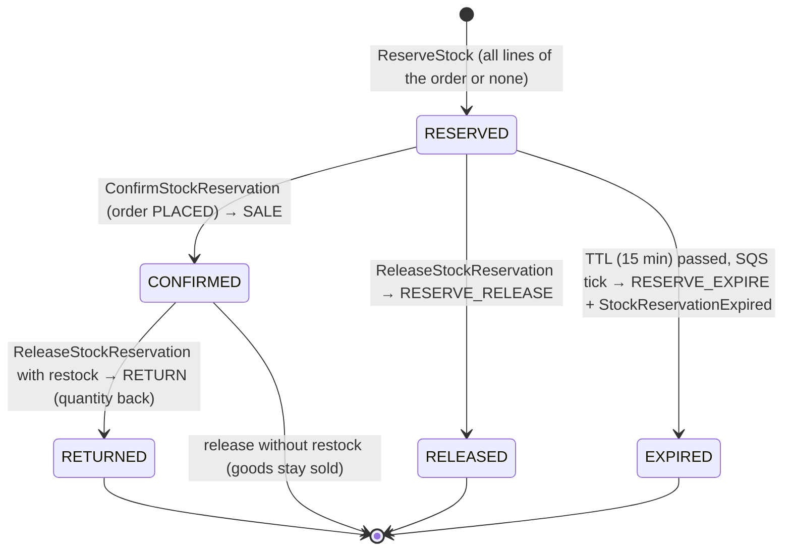
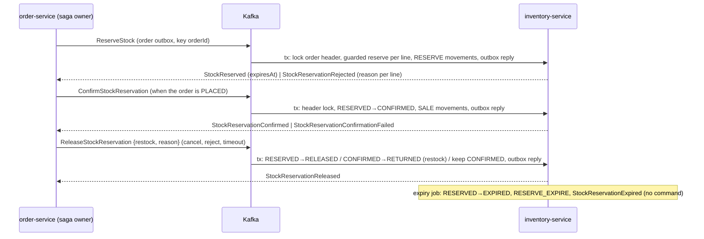

# Flow: Order → stock reservation lifecycle

Status: **designed** (ADR 0006, 2026-11-05). inventory's use cases (inventory-service#39) and its outbox replies
(inventory-service#40) are built, published by the connector `inventory-outbox-cdc` (development#7), with no entry point. order-service and the command consumers are not built.
Rules: BR-INV-02..05, 07, 08, 11, BR-CAT-04, BR-ORD-07, 09, 12, 14.

## Lifecycle of one reservation (one order line)

## Messages

## Order header (`stock_reservation_orders`)

One row per order: `merchant_id`, `store_id`, status `RESERVED | REJECTED | CONFIRMED | CANCELLED` (closed), `restock`
(set by the first release), and for `REJECTED` the rejection (`orderReason`, reason per rejected line) so a duplicate
reserve gets the same answer. Every command first takes this row under `FOR UPDATE`, scoped by `(order, merchant, store)`;
a row owned by another merchant/store is a contract error (DLT). A duplicate command changes nothing and re-publishes a
reply for the current state (BR-INV-07).

| Arrives out of order | Result |
|----------------------|--------|
| Release before Reserve (order timed out) | header created `CANCELLED` (tombstone); the late Reserve gets `Rejected{ORDER_CLOSED}`, nothing held |
| Confirm before Reserve | `ConfirmationFailed{UNKNOWN_ORDER}` and a tombstone (`restock` unset); a repeated confirm answers `ORDER_CLOSED`, a later Reserve is rejected `ORDER_CLOSED`, the first release still sets `restock` |
| Release before Confirm | RESERVED lines released, header `CANCELLED`; the late Confirm (also one replayed from a DLT) gets `ConfirmationFailed{ORDER_CLOSED}` |
| Release sent before the Confirmed reply arrived, confirm already applied (reachable only if obligation 3 is relaxed, open question 54) | with `restock`: lines `RETURNED`, stock back, `RETURN` movements; without: lines stay `CONFIRMED` (goods stay sold), header `CANCELLED`. How the saga treats the late `Confirmed`: open question 54 |
| Old command replayed from a DLT | decided by the header and line states; an old `ReserveStock` is also `STALE_COMMAND` |

order-service's obligations (ADR 0006): a saga that sent `ReserveStock` and was not rejected ends confirmed or released, also when no reply arrives (for a confirm step see open question 54); a `StockReserved`
for a closed saga is compensated; no release while a confirm has no reply (obligation 3, under review: open question 54); replies to commands deduplicated by
`(orderId, causationId, eventType)`, `StockReservationExpired` by `eventId`.

Audit note: a confirm that was applied and then cancelled with `restock` writes both a `SALE` and a `RETURN` movement
for goods never handed over; sales reports must net them by `reservation_id`.

### Inventory's guarantee

Any interleaving of confirm and release on one order ends in the state the commands
describe (header lock; no oversell, no double count); whether `restock = false` is right is order-service's choice.
Stock correctness never depends on order-service's timeouts.

## Lost replies (outbox rows are deleted at once, so a reply lost after commit cannot be re-published)

A reply can be lost when the connector's slot is dropped or recreated (open question 19). What brings the saga back:

| Lost reply | Recovery |
|------------|----------|
| `StockReserved` / `StockReservationRejected` | the saga times out and releases (obligation 1), or re-sends the reserve (the duplicate answers the stored outcome) |
| `StockReservationReleased` | inventory's state is already final; obligation 1 is met by the release; a re-send is optional and harmless |
| `StockReservationExpired` | a later confirm answers `NOT_RESERVED`; a release reports the line `EXPIRED` |
| `StockReservationConfirmed` / `StockReservationConfirmationFailed` | open question 54 (re-send the confirm, which is safe, or cancel; decided with order-service) |

## Duplicate commands (BR-INV-07)

A duplicate changes no stock and publishes a reply again (new `eventId`, `causationId` = the duplicate command's
`eventId`). Replies carry no "replayed" flag: order-service deduplicates by `(orderId, causationId, eventType)` and its
saga state (ADR 0006).

| Command | Header / lines found | Reply |
|---------|----------------------|-------|
| `ReserveStock`, same lines | header `RESERVED`, `CONFIRMED` or `CANCELLED` after a successful reserve | `StockReserved` with the lines and `expiresAt` of that reserve (the reserve step's outcome; later changes were reported by their own replies) |
| `ReserveStock`, different lines | header with reservations (compared with `stock_reservations`) | contract error → `ReserveStock.DLT`, nothing published |
| `ReserveStock` (lines not compared: nothing to compare with) | header `REJECTED` | `StockReservationRejected` with the stored reasons (the header keeps the rejection: `orderReason` and the reason per line) |
| `ReserveStock` (lines not compared) | header `CANCELLED` without any reservation (tombstone) | `StockReservationRejected{ORDER_CLOSED}` |
| `ConfirmStockReservation` | all lines `CONFIRMED` | `StockReservationConfirmed` |
| `ConfirmStockReservation` | header `REJECTED` / `CANCELLED`, or a line no longer `RESERVED` | `StockReservationConfirmationFailed` (`ORDER_CLOSED` / `NOT_RESERVED`) with the current line statuses |
| `ReleaseStockReservation` | header `CANCELLED` | `StockReservationReleased` with the current line statuses and the `restock` fixed by the first release (a different `restock` is logged at WARN and ignored) |
| `ReleaseStockReservation` | header `REJECTED` | `StockReservationReleased` with no lines; `restock` = the value stored by the first release (a different `restock` later is logged at WARN and ignored) |

## Reserve (one transaction, all-or-nothing per order, ≤ 100 lines)

1. `SET LOCAL lock_timeout` / `statement_timeout`; insert the header (`ON CONFLICT DO NOTHING`), then lock it by
   `(order, merchant, store)`; not found → owned by another merchant/store → contract error (DLT).
2. Header existed before this command → duplicate: compare the lines and answer from the table above. **This check
   comes before the stale check**, so a successful reserve redelivered after the TTL is not turned into a rejection.
3. Header just created and `occurredAt` older than the TTL (with a clock-skew tolerance) → header `REJECTED`,
   `Rejected{STALE_COMMAND}`.
4. Load inventories by `(merchant, store, sku IN …)`; a missing SKU or another product's SKU → `UNKNOWN_SKU`.
5. Domain pre-check per line in Java UUID order (INACTIVE → `NOT_ORDERABLE`, not enough → `INSUFFICIENT_STOCK`);
   any failure → header `REJECTED` (reasons stored) + reply, no update run.
6. Guarded `reserve … AND status = 'ACTIVE'` per line; at the first 0-row update, release the lines already held in
   this transaction, read the reasons with a scalar projection, header `REJECTED` (reasons stored) + reply.
7. Otherwise insert reservations (TTL from configuration, default 15 min), `RESERVE` movements, header `RESERVED`,
   outbox `StockReserved`.

## Timeouts (how they surface, and how the error handler must treat them)

Each command transaction sets `lock_timeout` 3 s and `statement_timeout` 5 s (`SET LOCAL`) and has a 10 s transaction
timeout (`app.reservation.*`; `StockCommandTransactionIT` asserts that reserve / confirm / release take it from the property). All
three are transient, not contract errors: retried with a bounded backoff like other failures in `KafkaErrorHandlingConfig`,
then `<topic>.DLT` (decided 2026-11-08: unlimited retries would block the order's partition if a command times out every
time; a command in a DLT is covered by ADR 0006 — the saga times out and releases (for a confirm step see open question
54), the hold TTL is the last net). Never
dead-lettered at once like a contract error. As asserted by `StockConcurrencyIT`:
`lock_timeout` → `PessimisticLockingFailureException` (SQLState 55P03); `statement_timeout` → Spring
`QueryTimeoutException` (57014); a query created after the deadline → `TransactionTimedOutException`. Not covered by a
test: Hibernate also gets the deadline in whole seconds and may refuse a statement (or the flush at commit) in the last
second with `org.hibernate.TransactionException` (likely translated to `JpaSystemException`), and a statement running at
the deadline is cancelled by the JDBC query timeout (57014). No timeout-specific handling is needed: the default bounded
policy already applies. What matters is that a timeout is never matched as a contract error (DLT at once) or as a
connection failure (unlimited retries). So when the command consumers add their contract exceptions to the not-retryable
list or widen the connection-failure check, a test must show, by cause chain (SQLState 55P03 / 57014,
`TransactionTimedOutException`, a "transaction timeout expired" Hibernate `TransactionException`), that timeouts still get
the bounded retries and then the DLT.

## Locks

Global order: order header → reservations (id ascending) → inventories (Java `UUID.compareTo`). Expiry takes only
reservation → one inventory and never the header, so it cannot form a cycle; confirm × expire and release × expire are
decided by the guarded `status = 'RESERVED'` updates.

## What exists today

| Step | inventory-service code | Entry point |
|------|------------------------|-------------|
| Reserve | `ReserveStockService`: header, duplicate / stale checks, reasons, guarded reserve, `RESERVE` movements → `ReserveStockResult` | none |
| Confirm | `ConfirmStockReservationService`: header (tombstone if missing), `SALE` movements → `ConfirmStockReservationResult` | none |
| Expire | `ExpireStockReservationService` → `ExpireByInventoryTransaction`: `RESERVE_EXPIRE` movements, `StockReservationExpired` per (order, merchant, store) | `SqsReservationExpireConsumer` |
| Release | `ReleaseStockReservationService`: `RESERVE_RELEASE` / `RETURN` movements, `restock` fixed by the first release → `ReleaseStockReservationResult` | none |

Every result above is written as its reply to `outbox_events` in the same transaction (`StockReplyFactory`,
`OutboxEventPersistenceAdapter`): inserted with `id = eventId` and deleted at once; Debezium publishes it from the
WAL. Published by `inventory-outbox-cdc` once registered (development#7).

Delivery plan (one PR each, in order): workspace docs and contracts ✅ → oms-web (missing record = not orderable, hold
movement types) ✅ → inventory reservation hardening ✅ → inventory outbox ✅ → `development` connector `inventory-outbox-cdc` ✅ (development#7)
(insert-only publication; Verify a–g passed locally, `development` `docs/connectors.md` *First application*) → stores-service outbox delete-after-insert + open question 45 ✅ (stores-service#59, development#8)
→ inventory command consumers → DLT tooling.
