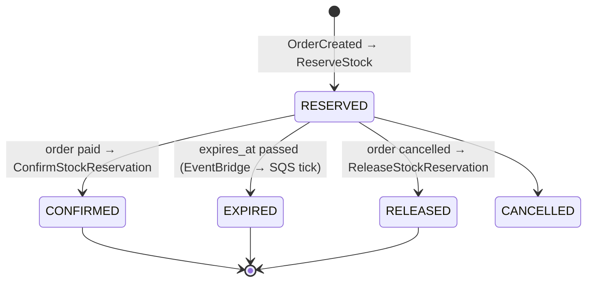

# Flow: Order → stock reservation lifecycle

Status: **partially built**. Inventory side (domain + services) exists; order-service and the
event wiring do not.

## What exists

| Step | inventory-service code | Entry point |
|------|------------------------|-------------|
| Reserve | `ReserveStockService` | none (OrderCreated listener commented out) |
| Confirm | `ConfirmStockReservationService` | none |
| Expire | `ExpireStockReservationService` → `ExpireByInventoryTransaction` (`REQUIRES_NEW` per inventory) | `SqsReservationExpireConsumer` |
| Release | `ReleaseStockReservationUseCase` interface | none, no implementation |

## Open design points for whoever builds order-service

- Contract of `OrderCreated` / `OrderConfirmed` / `OrderCancelled`.
- How inventory reports back (e.g. `StockReserved` / `StockReservationFailed`) — inventory has no outbox yet.
- Saga owner: order-service orchestrates or choreography via events.
- Reservation TTL and what order does when a reservation expires.
