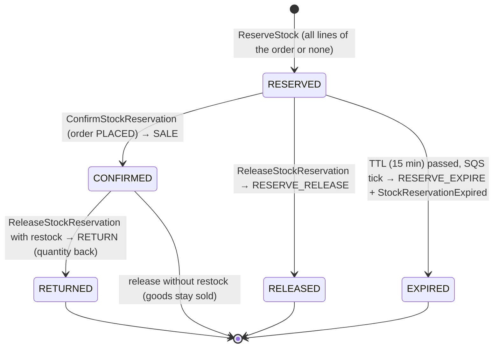
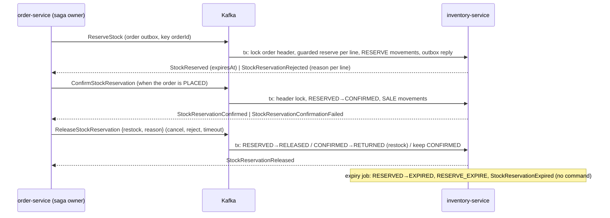

# Flow: Order → stock reservation lifecycle

Status: **designed** (ADR 0006, 2026-11-05). Inventory has the reserve / confirm / expire logic but no entry point
and no release implementation; order-service, the commands, the replies and inventory's outbox are not built.
Rules: BR-INV-02..05, 07, 08, 11, BR-CAT-04, BR-ORD-07, 09, 12, 14.

## Lifecycle of one reservation (one order line)

## Messages

## Order header (`stock_reservation_orders`)

One row per order: `merchant_id`, `store_id`, status `RESERVED | REJECTED | CONFIRMED | CANCELLED` (closed), `restock`
(set by the first release). Every command first takes this row under `FOR UPDATE`, scoped by `(order, merchant, store)`;
a row owned by another merchant/store is a contract error (DLT). A duplicate command changes nothing and re-publishes a
reply for the current state (`replayed: true`, BR-INV-07).

| Arrives out of order | Result |
|----------------------|--------|
| Release before Reserve (order timed out) | header created `CANCELLED` (tombstone); the late Reserve gets `Rejected{ORDER_CLOSED}`, nothing held |
| Confirm before Reserve | `ConfirmationFailed{UNKNOWN_ORDER}` and a tombstone |
| Release before Confirm | RESERVED lines released, header `CANCELLED`; the late Confirm gets `ConfirmationFailed{ORDER_CLOSED}` |
| Old command replayed from a DLT | decided by the header and line states; an old `ReserveStock` is also `STALE_COMMAND` |

order-service's obligations (ADR 0006): a saga that sent `ReserveStock` always ends with a release; a `StockReserved`
for a closed saga is compensated; no release while a confirm has no reply; replies deduplicated by
`(orderId, causationId, eventType)`.

## Reserve (one transaction, all-or-nothing per order, ≤ 100 lines)

1. `SET LOCAL lock_timeout` / `statement_timeout`; insert the header (`ON CONFLICT DO NOTHING`), then lock it.
2. Load inventories by `(merchant, store, sku IN …)`; a missing SKU or another product's SKU → `UNKNOWN_SKU`.
3. Domain pre-check per line in Java UUID order (INACTIVE → `NOT_ORDERABLE`, not enough → `INSUFFICIENT_STOCK`);
   any failure → header `REJECTED` + reply, no update run.
4. Guarded `reserve … AND status = 'ACTIVE'` per line; at the first 0-row update, release the lines already held in
   this transaction, read the reasons with a scalar projection, header `REJECTED` + reply.
5. Otherwise insert reservations (TTL from configuration, default 15 min), `RESERVE` movements, header `RESERVED`,
   outbox `StockReserved`.

## Locks

Global order: order header → reservations (id ascending) → inventories (Java `UUID.compareTo`). Expiry takes only
reservation → one inventory and never the header, so it cannot form a cycle; confirm × expire and release × expire are
decided by the guarded `status = 'RESERVED'` updates.

## What exists today

| Step | inventory-service code | Entry point |
|------|------------------------|-------------|
| Reserve | `ReserveStockService` (not idempotent, no status check, no movement) | none |
| Confirm | `ConfirmStockReservationService` (loads by `orderId` only, no movement) | none |
| Expire | `ExpireStockReservationService` → `ExpireByInventoryTransaction` (no movement, no event) | `SqsReservationExpireConsumer` |
| Release | `ReleaseStockReservationUseCase` interface | none, no implementation |

Delivery plan (one PR each, in order): workspace docs and contracts → oms-web (missing record = not orderable, hold
movement types) → inventory reservation hardening → inventory outbox → `development` connector `inventory-outbox-cdc` →
inventory command consumers → DLT tooling.
