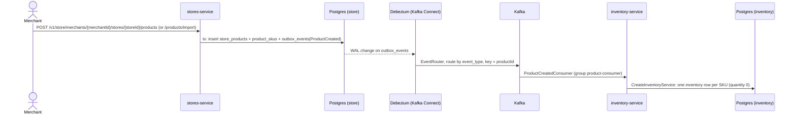

# Flow: Product created → inventory initialised

Status: **live**.

## Code entry points

- `stores-service`: `CreateStoreProductUseCaseService`, `ImportProductService`, `OutboxEventHelper`, `OutboxEventPersistenceAdapter`
- `inventory-service`: `ProductCreatedConsumer` → `CreateInventoryService`

## Things to watch when changing this flow

- Payload class exists in both services — keep them in sync.
- Delivery is at-least-once; `inventories` has unique (store_id, sku), so duplicates must be handled gracefully.
- Only `ProductCreated` exists — SKU added/removed, price change, product deactivated are **not** propagated yet.
