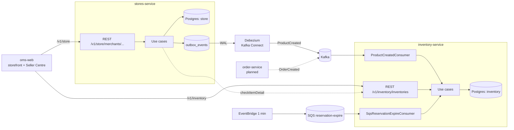

# System Overview



## Tech stack (all services)

Java 17 · Spring Boot 3.2.3 · Spring Data JPA / Hibernate 6.4 · PostgreSQL 16 + Flyway ·
MapStruct 1.6.3 · Lombok · SpringDoc OpenAPI · Kafka (spring-kafka) · Spring Cloud AWS SQS ·
AWS SDK v2 (S3) · Gradle with `oms-core` composite build · LocalStack for local AWS.

Front end (`oms-web`): React 19 · TypeScript (strict) · Vite · no runtime dependencies besides React;
layered `domain → ports → adapters / features → app` with the layer rule enforced by a test (`oms-web/docs/architecture.md`).

## Logging (MDC)

Text logs; every line starts with the MDC (`logging.pattern.correlation: "[%X] "`, both services). Keys (`oms-core` `MdcKeys`):
`requestId` (one per HTTP request, Kafka record or SQS message), every `...Id` UUID path variable (`merchantId`, `storeId`,
`productId`, `collectionId`, `inventoryId`, ...), and for messages `eventId`, `kafkaTopic`/`kafkaPartition`/`kafkaOffset`,
`sqsMessageId`. Search by `requestId` within a service. Across services, join stores' "Outbox event queued … eventId=" line with
inventory's consumer lines on `eventId` (the payload `eventId`, not `outbox_events.id`, open question 45); that line is DEBUG, so turn on
`logging.level.com.dotran.oms.store.infrastructure.persistence.OutboxEventPersistenceAdapter: DEBUG` first. A Kafka record keeps one
`requestId` (`topic-partition-offset`) across retries and on the DLT line (the recoverer reopens the scope); the error handler's own
retry lines have no MDC. `show_sql` lines bypass Logback.

## Service layout convention

```
com.dotran.oms.<context>/
├── domain/          model, valueobject, enums, event, exception — no Spring
├── application/     usecase (inbound ports), service (@UseCase impl), repository + client (outbound ports),
│                    command, dto, mapper, event (outbox factory), impex, jobs
└── infrastructure/  rest (@WebAdapter, dto, mapper, exception), persistence (@PersistenceAdapter, entity, jpa),
                     message (consumers + dto = ACL), mapper, cloud, swagger
```

Naming: `XxxUseCase` interface → `XxxService` implementation; `XxxCmd` input; `XxxDto` output;
`XxxRequest`/`XxxResponse` at the REST edge; `SpringDataXxxRepository` + `XxxPersistenceAdapter`.

Tests: JUnit per layer, mirrored package structure (domain model tests, service tests, adapter tests, controller tests).

## Multi-tenancy

Merchant isolation (`CLAUDE.md` rule 4, `vision.md`): merchant → store; customers are platform users.
- In stores-service, only `stores` has `merchant_id`; child tables are scoped by `store_id`.
- Every inventory-service table has `merchant_id`.

stores-service takes the merchant from the path (`/v1/store/merchants/{merchantId}/...`); inventory-service REST does not (open question 6).
Merchants are owned by stores-service (table `merchants`, FK from `stores`); inventory only stores the `merchant_id` it receives with `ProductCreated`.
