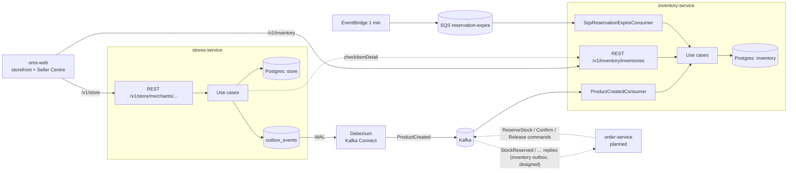

# System Overview



## Tech stack (all services)

Java 17 · Spring Boot 3.2.3 · Spring Data JPA / Hibernate 6.4 · PostgreSQL 16 + Flyway ·
MapStruct 1.6.3 · Lombok · SpringDoc OpenAPI · Kafka (spring-kafka) · Spring Cloud AWS SQS ·
AWS SDK v2 (S3) · Gradle; `oms-core` pinned by version from GitHub Packages (composite build locally, ADR 0005) · LocalStack for local AWS.

Front end (`oms-web`): React 19 · TypeScript (strict) · Vite · no runtime dependencies besides React;
layered `domain → ports → adapters / features → app` with the layer rule enforced by a test (`oms-web/docs/architecture.md`).

## Logging (MDC)

Text logs; every line starts with the MDC (`logging.pattern.correlation: "[%X] "`, both services). Keys (`oms-core` `MdcKeys`):
`requestId` (one per flow: the HTTP request's id, carried to Kafka consumers in the `correlationContext` header, ADR 0004;
`topic-partition-offset` for a record without it; the message id for SQS), the request values configured in `app.logging.mdc.fields`
(defaults: `merchantId`, `storeId`, `productId`, `collectionId`, `inventoryId`, `storeAvailabilityId` as UUID path variables), and for messages `eventId`, `kafkaTopic`/`kafkaPartition`/`kafkaOffset`,
`sqsMessageId`. Search by `requestId` across services: stores-service's request and inventory's consumer and DLT lines share it
(the browser's `X-Request-Id` when valid). All records of one Excel import share the import's id; to isolate one record use `eventId` or
`kafkaOffset`. `eventId` (the payload `eventId`, not `outbox_events.id`, open question 45) still joins stores' DEBUG "Outbox event queued"
line (`logging.level.com.dotran.oms.store.infrastructure.persistence.OutboxEventPersistenceAdapter: DEBUG`). A Kafka record keeps its
`requestId` across retries and on the DLT line (the recoverer reopens the scope); the error handler's own retry lines have no MDC.
`show_sql` lines bypass Logback.

`app.logging.mdc.fields` (oms-core `MdcProperties`): one entry per MDC key, merged into oms-core's defaults by each service.
Each entry has a `format` (`uuid`, `code` = `^[A-Za-z0-9._-]{1,64}$`, or `pattern` + a linear regex, values capped at 64), `sources`
(`path`, `query` = raw query string, caller-chosen, never for tenant ids) and `propagate`. A value that fails its format or has control
characters is not logged; a broken entry, a key differing only by case (environment variables lowercase map keys: use YAML or
`SPRING_APPLICATION_JSON`) or a request source on a reserved key (`requestId`, `eventId`, `kafka*`, `sqsMessageId`) fails startup. `propagate: true`
carries a key across services through the outbox header (ADR 0004; default: `requestId`). Only correlation keys may propagate: a key with a
request source (entity or tenant ids) or a message key fails startup. Never configure personal data. Body and payload values go through `MdcScope` in code.

## Service layout convention

```
com.dotran.oms.<context>/
├── domain/          model, valueobject, enums, event, exception — no Spring
├── application/     usecase (inbound ports), service (@UseCase impl), repository + client (outbound ports),
│                    command, dto, mapper, event (outbox factory), impex, jobs
└── infrastructure/  rest (@WebAdapter, dto, mapper, exception), persistence (@PersistenceAdapter, entity, jpa),
                     message (consumers + dto = ACL), mapper, cloud, swagger
```

Naming: `XxxUseCase` interface → `XxxService` implementation; `XxxCmd` input; `XxxDto` output;
`XxxRequest`/`XxxResponse` at the REST edge; `SpringDataXxxRepository` + `XxxPersistenceAdapter`.

Tests: JUnit per layer, mirrored package structure (domain model tests, service tests, adapter tests, controller tests).

## Multi-tenancy

Merchant isolation (`CLAUDE.md` rule 4, `vision.md`): merchant → store; customers are platform users.
- In stores-service, only `stores` has `merchant_id`; child tables are scoped by `store_id`.
- Every inventory-service table has `merchant_id`.

stores-service takes the merchant from the path (`/v1/store/merchants/{merchantId}/...`); inventory-service REST does not (open question 6).
Merchants are owned by stores-service (table `merchants`, FK from `stores`); inventory only stores the `merchant_id` it receives with `ProductCreated`.
