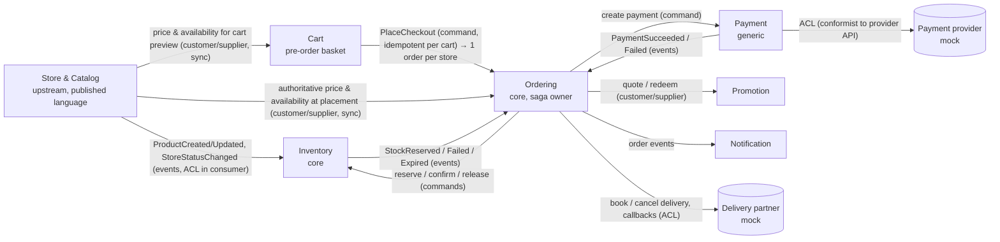
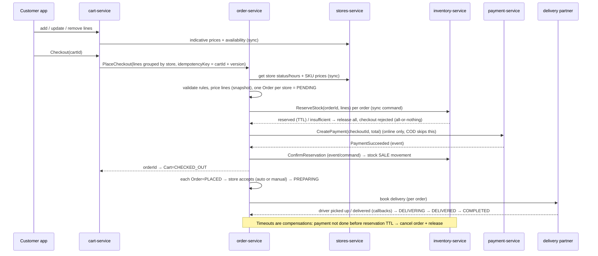

# OMS Vision & Context Map

> **Status:** reviewed with the product owner on 2026-10-25. Business decisions are in `business-rules.md`
> (🟢 Decided). Items marked *proposed* (relationships, flows, roadmap phases) are architecture
> recommendations: agents may use them as the default design, but flag them in plans.

## 1. Domain vision statement *(Q1, Q2, Q3, Q8, Q20b, Q32 decided 2026-10-25)*

A **multi-merchant marketplace** for **one market** (Vietnam, VND), operated by us.

```
Platform (one market: Vietnam, VND)
 ├─ Merchant = seller, often a chain (e.g. a tea chain, a coffee chain, a small bakery)   ← isolated from each other
 │   └─ Store = branch with its own hours, catalog and stock
 └─ Customer = platform user (one account for all merchants)
     └─ Cart → Checkout → one Order per store, one payment
```

- **Merchant** (formerly *tenant* in code). Merchants are isolated from each other: a merchant sees only its own stores, catalog, stock and orders.
- **Merchants** sell both made-to-order items (food & beverage) and stocked retail goods. One merchant = one seller company; it has one or more stores.
- **Customers** belong to the platform and use the **customer app** with an account. They fill one cart, possibly with items from stores of **different merchants**. At checkout the cart is split into **one order per store**. Each store accepts and prepares its order, and a **third-party delivery partner** brings it to the customer (pickup later). Customers pay by **COD or online** (one payment per checkout). Pre-orders for a later time slot are supported.
- **One market** for now: one currency (VND) and one set of rules for the whole platform. Adding a second country later means adding a "market" level above merchants.

**Two scopes of data:**
- **merchant-owned**: merchant, stores, catalog, inventory, and each order (an order belongs to one store, hence one merchant);
- **customer-owned** (platform level, no merchant): customer profile, cart, checkout and its payment, later settlement.

The platform covers **order management only**: payment gateways and delivery partners are external and
represented by **mock providers** behind ACLs.

The platform's value is to **take orders only for what the store can actually serve**:
- the store is open, or a pre-order is allowed;
- the product is on sale;
- stock is held for the order;
- the store has capacity.

The order then moves to completion with one reliable status that every party sees.

Original evidence for the "on-demand, store-fulfilled" reading: `StoreConfig` has `autoAcceptOrder`, `allowPreOrder`,
`preparationTimeMinutes`, `maxOrdersPerDay`; business hours and availability windows (`STAFF_SHORTAGE`,
`INVENTORY`, `HOLIDAY`); stock is per store; reservations expire after 30 minutes.

## 2. Subdomains

| Subdomain | Type | Why |
|-----------|------|-----|
| **Order management** (capture → accept → fulfil → complete/cancel) | **Core** | The product's differentiator: correct, fast order flow with no oversell. Build in-house, invest most here. |
| **Sellable availability** (stock, reservations, capacity) | **Core** | "Never sell what the store cannot serve" is the main promise. |
| Store & catalog (stores, hours, products, SKUs, collections) | Supporting | Needed, but standard; keep simple. |
| Shopping cart & checkout (build a multi-store basket, preview price, hand over to ordering) | Supporting | Customer-facing and high-traffic, but low risk: nothing is committed until checkout. |
| Pricing & promotion | Supporting | Can start with plain SKU price; promotions later. |
| Fulfillment & delivery (preparation, handover, third-party delivery booking and tracking) | Supporting | Delivery is by third-party partners (Q8): we own the booking state and translate partner callbacks; the partner owns the driver. |
| Customer | Supporting | Profile, addresses, order history. |
| Payment | **Generic** | Use a gateway; we own only the payment *state* and its reconciliation. |
| Merchant management | Supporting | Merchant onboarding, status, commission, users and roles. |
| Notification, Identity & access | Generic | Buy/standard components. |

## 3. Bounded contexts

| Context | Service | Status | Owns (aggregates) | Publishes | Consumes |
|---------|---------|--------|-------------------|-----------|----------|
| Store & Catalog | `stores-service` | built | `Store`, `StoreAvailability`, `StoreProduct`, `StoreCollection` | `ProductCreated`; *proposed*: `ProductUpdated`, `ProductStatusChanged`, `StoreStatusChanged` | — |
| Inventory | `inventory-service` | built (no order entry points) | `Inventory`, `StockReservation`, `StockMovement` | *proposed*: `StockReserved`, `StockReservationFailed`, `StockReservationExpired` | `ProductCreated`; *proposed*: order events |
| **Cart** | `cart-service` (platform level, owned by the customer) | planned | `Cart` (+ `CartLine`), one active cart per customer, lines from stores of several merchants | `CartCheckedOut` *(optional, for analytics)* | *proposed*: `ProductStatusChanged`, `ProductUpdated` (to flag unavailable lines) |
| **Ordering** | `order-service` | planned (next) | `Checkout` (owned by the customer, one payment) groups N `Order`s (each owned by one merchant/store, + `OrderLine` snapshots) | `OrderPlaced`, `OrderAccepted`, `OrderRejected`, `OrderCancelled`, `OrderCompleted` | inventory, payment, store events |
| Payment | `payment-service` (mock provider) | planned | `Payment` (intent, attempts, refunds) | `PaymentSucceeded`, `PaymentFailed`, `RefundSucceeded` | order events |
| Promotion | `promotion-service` | planned | `Promotion`, `Voucher`, redemption | `VoucherRedeemed` | order events |
| Fulfillment & delivery | inside `order-service` first (mock partner); own service when a real partner or own fleet arrives | planned | `DeliveryBooking` per order | — | partner callbacks (via ACL) |
| Customer | planned (platform level) | planned | `Customer`, addresses | — | — |
| Discovery / search | planned (read model) | later (Q30) | search index of stores and products across merchants | — | catalog and store events |
| Settlement | planned (mock payouts) | later (Q29) | per-merchant balance, commission, payouts | — | order and payment events |
| Notification | planned | planned | templates, delivery log | — | all customer-facing events |
| Merchant | `<profile>_merchant_info` (DynamoDB) = merchant profile today; `Merchant` aggregate inside `stores-service` later | partial: profile in DynamoDB, no merchant aggregate/API yet | `MerchantInfo` → `Merchant`, merchant users and roles | *proposed*: `MerchantStatusChanged` | — |
| Identity | IdP (to choose) | planned | customer and merchant accounts, tokens with `customerId` or `merchantId` + roles | — | — |

**Rule of thumb for new contexts:**
- a context gets its own service when it has its own lifecycle, its own team concern, or a different scaling/consistency need;
- otherwise it starts as a module inside the closest service. Fulfillment, for example, starts inside order-service.

## 4. Context map *(proposed relationships)*



- **Store & Catalog is upstream** and publishes a stable *published language*: event JSON Schemas in `contracts/events/`. Every downstream context translates those events in its own ACL (`infrastructure/message/dto`).
- **Cart is a pre-step to ordering**:
  - it collects lines and shows an *indicative* price;
  - it commits nothing: no stock hold, no payment;
  - at checkout it sends **one** `PlaceCheckout` to order-service with the cart id + version as the idempotency key; order-service splits it into one order per store.
  - Order-service re-validates and re-prices everything (BR-ORD-02/03), so a stale cart can never produce a wrong order.
- **Ordering owns the order saga** (orchestration, decided Q6). It decides what happens next; inventory and payment execute and report back.
- **Payment hides the gateway** and **delivery hides the partner** behind ACLs, so changing provider changes nothing outside them.
- No context reads another's database (system rule 1). Synchronous calls are for reads that must be fresh at checkout and for "can I?" commands. State changes travel as events through the outbox.

## 5. Ubiquitous language — terms that change meaning across contexts

| Term | Store & Catalog | Inventory | Ordering |
|------|-----------------|-----------|----------|
| Product / SKU | live catalog item, price can change | stock key (store, SKU) | in Cart: a reference + indicative price, refreshed on view; in Ordering: **snapshot** on an `OrderLine` (name, SKU, unit price at placement) — never re-read later |
| Available | product `ACTIVE` and store open | `quantity − reserved` | can be ordered now = all of these |
| Reservation | — | hold of stock with TTL | the order's claim on stock until paid/accepted |
| Cart vs order vs checkout | — | — | a cart is a wish list that can change freely; a checkout is one customer action that creates one order per store; an order is the commitment of one store |
| Cancel | — | release a hold | order state change with a reason and an actor (customer, store, system) |
| Store open | business hours + availability windows | — | checked at placement (and for pre-order, at the slot) |

## 6. Core flow: place an order *(proposed, see BR-ORD, Q4–Q8)*



## 7. Roadmap *(proposed)*

| Phase | Goal | Contents |
|-------|------|----------|
| 0. Harden | Safe base for orders | Open questions 24–27 (import outbox, S3 bucket, SKU uniqueness, collection scoping), 13 (idempotent reserve), 8 (release + entry points), inventory outbox, 17/18 (DLT/DLQ), CI tests |
| 1. Cart + Order MVP | Take an order end to end | `cart-service` (one multi-store cart per customer, indicative prices, checkout → `PlaceCheckout`) and `order-service`: split per store, line snapshots, reserve on placement, store accept/reject, statuses to `COMPLETED`, cancel before acceptance; **COD** first, delivery fee from the partner quote. Delivery comes first and pickup later (Q25), so the MVP includes the **mock delivery partner** |
| 2. Payment | Online payment | `payment-service` with a **mock** payment provider (one payment per checkout), reservation TTL aligned with the payment window, refunds on cancel |
| 3. Promotion & settlement | Discounts, merchant payouts | Platform and shop vouchers (Q31), snapshot on the order; settlement: commission, merchant balances, mocked payouts (Q29) |
| 4. Delivery & notifications | More partners, customer updates | Second delivery partner (delivery-service split out), notification service |
| Later | Returns, reporting, pickup, search | Return/refund flow, analytics read models, pickup (Q25), search across stores (Q30). Pre-order (Q7, up to the next day) fits in phase 1–2 |

## 8. Out of scope (until decided otherwise)
More than one market (countries, currencies), cross-border checkout, real payment gateways, real delivery partners, POS orders, guest orders, multi-currency, split shipments, B2B invoicing, loyalty points.
